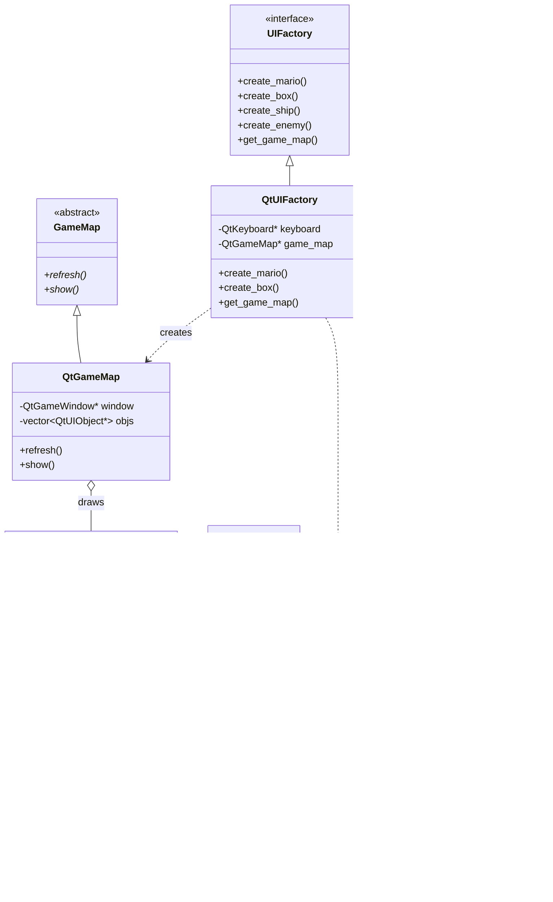
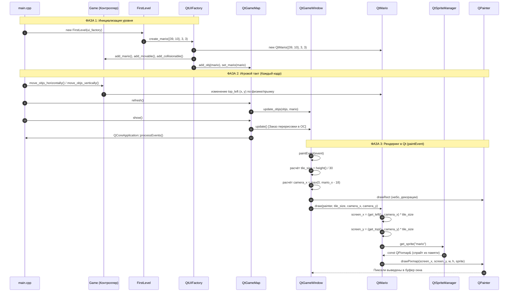

# Руководство по архитектуре графической версии Super Mario на Qt (Спрайты)

Данный документ содержит подробное описание всех компонентов, классов, паттернов проектирования и архитектурных решений, добавленных для реализации графического интерфейса Super Mario с использованием спрайтов на базе фреймворка **Qt (Qt5 / Qt6)**.

---

## 📑 Содержание

1. [Цели и архитектурные принципы](#1-цели-и-архитектурные-принципы)
2. [Общая диаграмма архитектуры](#2-общая-диаграмма-архитектуры)
3. [Структура добавленных файлов](#3-структура-добавленных-файлов)
4. [Подробный разбор классов и модулей](#4-подробный-разбор-классов-и-модулей)
   - [QtUIObject — базовый интерфейс отрисовки](#qtuiobject)
   - [QtUIObjectRectAdapter — паттерн Адаптер (Adapter)](#qtuiobjectrectadapter)
   - [QtSpriteManager — паттерн Одиночка (Singleton) и спрайтовая система](#qtspritemanager)
   - [QtKeyboard — кроссплатформенный ввод через Qt](#qtkeyboard)
   - [QtControlSettings — настройки окружения](#qtcontrolsettings)
   - [QtGameWindow — окно игры и рендеринг кадра](#qtgamewindow)
   - [QtGameMap — реализация абстрактной карты GameMap](#qtgamemap)
   - [QtUIFactory — паттерн Абстрактная Фабрика (Abstract Factory)](#qtuifactory)
   - [Иерархия графических объектов (ui_objects)](#иерархия-графических-объектов-ui_objects)
5. [Решение проблемы растяжения текстур (Тайлинг)](#5-решение-проблемы-растяжения-текстур-тайлинг)
6. [Минимальные изменения в `main.cpp` и игровой цикл](#6-минимальные-изменения-в-maincpp-и-игровой-цикл)
7. [Конфигурация CMake и кроссплатформенность](#7-конфигурация-cmake-и-кроссплатформенность)
8. [Инструкция по сборке и запуску](#8-инструкция-по-сборке-и-запуску)
9. [Управление в игре](#9-управление-в-игре)
10. [Полный цикл отрисовки Марио (пошаговый разбор)](#10-полный-цикл-отрисовки-марио-пошаговый-разбор)
11. [Справочник API: детальное описание каждого нового класса и каждой функции](#11-справочник-api-детальное-описание-каждого-нового-класса-и-каждой-функции)

---

## 1. Цели и архитектурные принципы

При реализации графической версии на Qt соблюдались следующие ключевые требования:
1. **Изоляция UI**: вся специфика Qt вынесена в папку `src/ui/qt/` и не смешивается с игровой моделью или физикой.
2. **Неизменность игрового цикла и контроллера**: класс `Game` и цикл `do { ... } while (!game.is_finished());` в `main.cpp` остались неизменными.
3. **Паттерны проектирования**:
   - **MVC (Model-View-Controller)**: логика движения и коллизий отделена от графического отображения.
   - **Abstract Factory (`UIFactory`)**: `QtUIFactory` создает семейство графических объектов, не раскрывая их конкретные типы игровому контроллеру и уровням.
   - **Adapter (`QtUIObjectRectAdapter`)**: адаптирует логические координаты `Rect` к интерфейсу отрисовки `QtUIObject`.
   - **Singleton (`QtSpriteManager`)**: централизованно хранит, кэширует и поставляет спрайты без дублирования в памяти.
4. **Фиксированные текстуры**: блоки кирпичей, земли и платформ не искажаются и не растягиваются, а замощаются тайлами фиксированного размера.
5. **Кроссплатформенность**: приложение одинаково собирается и работает на Windows и Linux.

---

## 2. Общая диаграмма архитектуры



---

## 3. Структура добавленных файлов

Все новые компоненты размещены в каталоге `src/ui/qt`:

```
src/ui/qt/
├── CMakeLists.txt                # Сборка модуля Qt и включение AUTOMOC/AUTORCC
├── resources.qrc                 # Файл ресурсов Qt со всеми запеченными спрайтами
├── qt_ui_obj.hpp                 # Базовый интерфейс графического объекта
├── qt_ui_obj_rect_adapter.hpp    # Класс-адаптер между Rect и QtUIObject
├── qt_ui_obj_rect_adapter.cpp
├── qt_sprite_manager.hpp         # Менеджер загрузки и кэширования спрайтов (Singleton)
├── qt_sprite_manager.cpp
├── qt_keyboard.hpp               # Реализация KeyBoard через события Qt
├── qt_keyboard.cpp
├── qt_control_settings.hpp       # Реализация OSControlSettings для GUI
├── qt_control_settings.cpp
├── qt_game_window.hpp            # Окно игры (QWidget), холст рендеринга и обработчик ввода
├── qt_game_window.cpp
├── qt_game_map.hpp               # Реализация GameMap для управления окном и объектами
├── qt_game_map.cpp
├── qt_ui_factory.hpp             # Абстрактная фабрика QtUIFactory
├── qt_ui_factory.cpp
├── resources/
│   ├── generate_sprites.py       # Скрипт воссоздания 8-битных пиксельных спрайтов
│   └── sprites/                  # Папка с PNG спрайтами
│       ├── mario.png
│       ├── box.png
│       ├── full_box.png
│       ├── empty_box.png
│       ├── ground_top.png
│       ├── ground_sub.png
│       ├── enemy.png
│       ├── flying_enemy.png
│       ├── jumping_enemy.png
│       ├── money.png
│       ├── moving_platform.png
│       ├── finish.png
│       ├── cloud.png
│       └── bush.png
└── ui_objects/                   # Конкретные графические реализации игровых сущностей
    ├── CMakeLists.txt
    ├── qt_mario.hpp / .cpp
    ├── qt_box.hpp / .cpp
    ├── qt_full_box.hpp / .cpp
    ├── qt_ship.hpp / .cpp
    ├── qt_enemy.hpp / .cpp
    ├── qt_flying_enemy.hpp / .cpp
    ├── qt_jumping_enemy.hpp / .cpp
    ├── qt_moving_platform.hpp / .cpp
    ├── qt_money.hpp / .cpp
    └── qt_finish.hpp / .cpp
```

Также в корне проекта созданы скрипты автоматизации:
- `build_qt.bat` / `build_qt.sh` — кроссплатформенная сборка проекта с флагом `-DGAME_TYPE=Qt`.
- `run_qt.bat` / `run_qt.sh` — запуск скомпилированного графического приложения.

---

## 4. Подробный разбор классов и модулей

### `QtUIObject`
**Файл**: [`src/ui/qt/qt_ui_obj.hpp`](file:///c:/IT/super_mario/src/ui/qt/qt_ui_obj.hpp)

Абстрактный интерфейс для любого графического объекта в Qt. Определяет контракт:
- Предоставление геометрических границ в единицах игровой сетки (`get_left()`, `get_top()`, `get_right()`, `get_bottom()`, `get_width()`, `get_height()`).
- Чисто виртуальный метод `draw(QPainter& painter, int tile_size, int camera_x, int camera_y) const = 0`, отвечающий за рисование объекта.

---

### `QtUIObjectRectAdapter`
**Файлы**: [`src/ui/qt/qt_ui_obj_rect_adapter.hpp`](file:///c:/IT/super_mario/src/ui/qt/qt_ui_obj_rect_adapter.hpp), [`qt_ui_obj_rect_adapter.cpp`](file:///c:/IT/super_mario/src/ui/qt/qt_ui_obj_rect_adapter.cpp)

Реализация паттерна **Adapter** (через множественное наследование `virtual public Rect` и `public QtUIObject`).
Он избавляет конкретные классы объектов от дублирования кода трансляции координат: методы `get_left()`, `get_top()`, `get_right()`, `get_bottom()`, `get_width()` перенаправляются к полям родительского прямоугольника `Rect`.

---

### `QtSpriteManager`
**Файлы**: [`src/ui/qt/qt_sprite_manager.hpp`](file:///c:/IT/super_mario/src/ui/qt/qt_sprite_manager.hpp), [`qt_sprite_manager.cpp`](file:///c:/IT/super_mario/src/ui/qt/qt_sprite_manager.cpp)

Реализация паттерна **Singleton**:
- Хранит кэш `std::unordered_map<std::string, QPixmap>`.
- Метод `get_sprite(name)` проверяет наличие в кэше. Если спрайта нет, загружает его:
  1. Сначала из ресурсов Qt (`":/sprites/resources/sprites/<name>.png"`), которые вкомпилированы прямо в `.exe`.
  2. Если ресурсы недоступны, пробует загрузить файл с диска.
  3. Если файл не найден, программно генерирует fallback-заливку нужного цвета, гарантируя, что программа **никогда не упадет** из-за отсутствия ассета.

---

### `QtKeyboard`
**Файлы**: [`src/ui/qt/qt_keyboard.hpp`](file:///c:/IT/super_mario/src/ui/qt/qt_keyboard.hpp), [`qt_keyboard.cpp`](file:///c:/IT/super_mario/src/ui/qt/qt_keyboard.cpp)

Реализация интерфейса `biv::KeyBoard` для Qt.
- **Принцип работы**:
  - Окно `QtGameWindow` перехватывает события `keyPressEvent`, `keyReleaseEvent` и `closeEvent` и пересылает их в методы `QtKeyboard::handle_key_press`, `handle_key_release`, `handle_close`.
  - Клавиатура отслеживает множество зажатых клавиш в `std::unordered_set<int> pressed_keys`.
  - При вызове `get_user_input()`:
    1. Вызывается `QCoreApplication::processEvents()`, что обрабатывает очередь оконных событий без блокировки потока.
    2. Проверяется флаг закрытия окна или клавиши `Q` / `Esc` -> возвращается `UserInput::EXIT`.
    3. Проверяется запрос на прыжок (`Space` / `W` / `Вверх`) -> возвращается `UserInput::MARIO_JUMP`.
    4. Проверяются клавиши `A` / `Влево` -> `UserInput::MAP_RIGHT` (карта вправо, Марио идет влево).
    5. Проверяются клавиши `D` / `Вправо` -> `UserInput::MAP_LEFT` (карта влево, Марио идет вправо).
    6. Иначе возвращается `UserInput::NO_INPUT`.
  - Метод `off()` сбрасывает все флаги нажатия, что предотвращает "залипание" клавиш при гибели Марио или смене уровня.

---

### `QtControlSettings`
**Файлы**: [`src/ui/qt/qt_control_settings.hpp`](file:///c:/IT/super_mario/src/ui/qt/qt_control_settings.hpp), [`qt_control_settings.cpp`](file:///c:/IT/super_mario/src/ui/qt/qt_control_settings.cpp)

Реализация интерфейса `OSControlSettings`.
В консольных версиях этот класс скрывал курсор терминала и позиционировал вывод. В GUI-версии на Qt эти операции не требуются, поэтому методы `init()` и `set_cursor_start_position()` безопасно реализованы без лишних действий, полностью соблюдая контракт интерфейса.

---

### `QtGameWindow`
**Файлы**: [`src/ui/qt/qt_game_window.hpp`](file:///c:/IT/super_mario/src/ui/qt/qt_game_window.hpp), [`qt_game_window.cpp`](file:///c:/IT/super_mario/src/ui/qt/qt_game_window.cpp)

Виджет окна игры на базе `QWidget`:
- **Разрешение**: по умолчанию 1200x720 пикселей (высота 30 тайлов по 24 пикселя).
- **Камера**: отслеживает координату `x` Марио. Камера держит Марио в левой части экрана (`camera_x = max(0, mario_x - 18)`), предоставляя игроку хороший обзор препятствий и врагов впереди.
- **Отрисовка кадра в `paintEvent`**:
  1. Заливка фона классическим цветом неба Super Mario NES (`RGB 92, 148, 252`).
  2. Рисование параллакс-декораций (облака в небе и кусты на горизонте).
  3. Отрисовка всех зарегистрированных объектов уровня (`obj->draw(...)`).
  4. Отрисовка синего океана с гребнем волны внизу карты (строки 27–30).
  5. Отрисовка аркадного HUD (`MARIO`, `WORLD 1-1`, `TIME`).

---

### `QtGameMap`
**Файлы**: [`src/ui/qt/qt_game_map.hpp`](file:///c:/IT/super_mario/src/ui/qt/qt_game_map.hpp), [`qt_game_map.cpp`](file:///c:/IT/super_mario/src/ui/qt/qt_game_map.cpp)

Реализация абстрактного класса `GameMap`:
- Инкапсулирует владение объектом окна `QtGameWindow`.
- Хранит вектор графических объектов `std::vector<QtUIObject*> objs`.
- В методе `refresh()` передает актуальный список объектов и Марио в окно.
- В методе `show()` инициирует перерисовку окна `window->update()` и обрабатывает события `QCoreApplication::processEvents()`.

---

### `QtUIFactory`
**Файлы**: [`src/ui/qt/qt_ui_factory.hpp`](file:///c:/IT/super_mario/src/ui/qt/qt_ui_factory.hpp), [`qt_ui_factory.cpp`](file:///c:/IT/super_mario/src/ui/qt/qt_ui_factory.cpp)

Реализация паттерна **Abstract Factory** (наследует `UIFactory`):
- Инстанциирует конкретные классы с префиксом `Qt*` (`QtMario`, `QtBox`, `QtShip` и т.д.).
- Регистрирует созданные объекты в логических подсистемах контроллера `Game`:
  - `game->add_static_obj(box)`
  - `game->add_movable(enemy)`
  - `game->add_collisionable(enemy)`
  - `game->add_map_movable(ship)`
- Добавляет графические объекты в карту: `game_map->add_obj(...)`.
- Управляет корректной очисткой памяти в `clear_data()` и деструкторе.

---

### Иерархия графических объектов (`ui_objects`)

Каждый объект игры в Qt наследуется от соответствующего класса предметной области (`Mario`, `Enemy`, `Box` и т.д.) и от адаптера `QtUIObjectRectAdapter`:

| Класс | Родители | Отображаемый спрайт / Поведение |
|---|---|---|
| `QtMario` | `Mario`, `QtUIObjectRectAdapter` | Неизменяемый аутентичный спрайт Марио (красная кепка, синий комбинезон). Движется и прыгает. |
| `QtBox` | `Box`, `QtUIObjectRectAdapter` | Кирпичный блок (`box.png`). Замощается плитками 1×1 тайл. |
| `QtFullBox` | `FullBox`, `QtUIObjectRectAdapter` | Вопросительный блок. Если активен — золотистый `?` (`full_box.png`), если выбит — металлический блок (`empty_box.png`). |
| `QtShip` | `Ship`, `QtUIObjectRectAdapter` | Поверхность уровня / корабль. Верхний ряд — трава/палуба (`ground_top.png`), нижние ряды — подземный грунт (`ground_sub.png`). |
| `QtEnemy` | `Enemy`, `QtUIObjectRectAdapter` | Классический гриб Гумба (`enemy.png`). |
| `QtFlyingEnemy` | `FlyingEnemy`, `QtUIObjectRectAdapter` | Летающий враг с крыльями (`flying_enemy.png`). |
| `QtJumpingEnemy` | `JumpingEnemy`, `QtUIObjectRectAdapter` | Прыгающий враг (`jumping_enemy.png`). |
| `QtMovingPlatform`| `MovingPlatform`, `QtUIObjectRectAdapter` | Парящая деревянная платформа (`moving_platform.png`), тайлится по ширине. |
| `QtMoney` | `Money`, `QtUIObjectRectAdapter` | Золотая монетка Super Mario (`money.png`). |
| `QtFinish` | `Finish`, `QtUIObjectRectAdapter` | Замок / финишный флагшток (`finish.png`). |

---

## 5. Решение проблемы растяжения текстур (Тайлинг)

В ответе на вопрос №3 было указано:
> *"В Марио все блоки имеют фиксированную ширину и длину, что позволяет их текстурам не растягиваться... Размер объекта фиксированный через спрайты, как в игре."*

Для выполнения этого требования отрисовка протяженных объектов (`Ship`, `Box`, `FullBox`, `MovingPlatform`) реализована по принципу **тайлинга (замощения)**:
Вместо растягивания одной картинки на весь прямоугольник `width × height`, объект делится на ячейки 1×1 тайл, и текстура рисуется в цикле для каждой ячейки:

```cpp
// Пример из QtBox::draw:
const QPixmap& sprite = QtSpriteManager::instance().get_sprite("box");
for (int i = 0; i < get_width(); ++i) {
    for (int j = 0; j < get_height(); ++j) {
        painter.drawPixmap(
            screen_x + i * tile_size,
            screen_y + j * tile_size,
            tile_size,
            tile_size,
            sprite
        );
    }
}
```

Для земли (`QtShip`) верхний ряд рисуется спрайтом поверхности `ground_top`, а внутренние слои — грунтом `ground_sub`. Благодаря этому визуальный стиль выглядит в точности как на приставке NES.

---

## 6. Организация `main.cpp` и паттерн AppFactory

В `src/main.cpp` инициализация платформенных зависимостей вынесена в паттерн **Abstract Factory** (`AppFactory`):

1. **Базовый интерфейс `AppFactory` (`src/app_factory.hpp`)**:
   Определяет контракт создания окружения ОС:
   - `create_control_settings()` — создает настройки курсора/терминала или GUI.
   - `create_keyboard()` — создает обработчик клавиатуры для конкретной платформы.
   - `get_frame_delay()` — возвращает задержку между кадрами (мс).

2. **Конкретные фабрики окружения**:
   - `QTFactory` (`src/qt_factory.hpp / .cpp`) — инкапсулирует `QApplication app(argc, argv)`, возвращает `QtControlSettings`, `QtKeyboard` и задержку 20 мс.
   - `WindowsAppFactory` (`src/windows_factory.hpp / .cpp`) — возвращает `WindowsControlSettings`, `WindowsKeyBoard` и задержку 10 мс.
   - `LinuxAppFactory` (`src/linux_factory.hpp / .cpp`) — возвращает `LinuxControlSettings`, `LinuxKeyboard` и задержку 50 мс.

3. **Компактная инициализация в `main.cpp`**:
   ```cpp
   biv::AppFactory* app_factory = nullptr;
   #ifdef QT_GUI
       app_factory = new biv::QTFactory(argc, argv);
   #elif defined(WINDOWS_CONSOLE)
       app_factory = new biv::WindowsAppFactory();
   #elif defined(LINUX_CONSOLE)
       app_factory = new biv::LinuxAppFactory(map_height, map_weight);
   #endif

   biv::OSControlSettings* control_settings = app_factory->create_control_settings();
   biv::KeyBoard* keyboard = app_factory->create_keyboard();
   auto frame_delay = app_factory->get_frame_delay();
   ```

4. **Создание фабрики UI**:
   ```cpp
   #ifdef QT_GUI
       biv::UIFactory* ui_factory = new biv::QtUIFactory(&game, dynamic_cast<biv::QtKeyboard*>(keyboard));
   #else
       biv::UIFactory* ui_factory = new biv::ConsoleUIFactory(&game);
   #endif
   ```

**Весь остальной код `main.cpp` остался без изменений**:
- Получение ввода через `keyboard->get_user_input()`.
- Вызовы `game.move_objs_horizontally()`, `game.move_objs_vertically()`.
- Все проверки столкновений и смены уровней.
- `game_map->refresh()`, `control_settings->set_cursor_start_position()`, `game_map->show()`.
- Задержка `std::this_thread::sleep_for(frame_delay)`.

---

## 7. Конфигурация CMake и кроссплатформенность

В корневом файле `src/CMakeLists.txt` добавлена поддержка флага `GAME_TYPE=Qt`:

```cmake
if(GAME_TYPE STREQUAL "Qt")
    find_package(QT NAMES Qt6 Qt5 REQUIRED COMPONENTS Core Gui Widgets)
    find_package(Qt${QT_VERSION_MAJOR} REQUIRED COMPONENTS Core Gui Widgets)
    set_target_properties(${PROJECT_NAME} PROPERTIES AUTOMOC ON AUTORCC ON AUTOUIC ON)
    target_link_libraries(${PROJECT_NAME} Qt${QT_VERSION_MAJOR}::Core Qt${QT_VERSION_MAJOR}::Gui Qt${QT_VERSION_MAJOR}::Widgets)
    target_compile_definitions(${PROJECT_NAME} PRIVATE QT_GUI)
endif()
```

В `src/ui/CMakeLists.txt`:
```cmake
if(GAME_TYPE STREQUAL "Qt")
    add_subdirectory(qt)
else()
    add_subdirectory(console)
endif()
```

Таким образом:
- При сборке с `-DGAME_TYPE=Qt` компилируется графическая версия на Qt.
- При сборке с `-DGAME_TYPE=WindowsConsole` или `LinuxConsole` проект компилируется в оригинальном консольном виде без зависимостей от библиотек Qt.

---

## 8. Инструкция по сборке и запуску

### Windows (через Ninja / GCC / MinGW / MSYS2)

1. **Сборка**:
   Запустите командный файл:
   ```cmd
   build_qt.bat
   ```
   Скрипт автоматически найдет компилятор и библиотеки Qt (например, из `C:\msys64\ucrt64\bin`), сконфигурирует CMake и соберет исполняемый файл в папке `build_qt/`.

2. **Запуск**:
   ```cmd
   run_qt.bat
   ```
   (или запустите напрямую `build_qt\super_mario.exe`).

---

### Linux

1. **Сборка**:
   ```bash
   chmod +x build_qt.sh run_qt.sh
   ./build_qt.sh
   ```

2. **Запуск**:
   ```bash
   ./run_qt.sh
   ```

---

## 9. Управление в игре

| Действие | Клавиши в Qt |
|---|---|
| Движение влево | `A` или `Стрелка влево` |
| Движение вправо | `D` или `Стрелка вправо` |
| Прыжок | `Space` (Пробел), `W` или `Стрелка вверх` |
| Выход из игры | `Q`, `Esc` или клик по крестику окна |

---

## 10. Полный цикл отрисовки Марио (пошаговый разбор)

Чтобы понять, как абстрактные координаты Марио превращаются в цветные пиксели на экране монитора, проследим цепочку вызовов от инициализации до рендеринга.



### Пошаговое объяснение цепочки:

1. **Создание объекта (`QtUIFactory::create_mario`)**:
   - Фабрика создает экземпляр класса `QtMario` с координатами сетки `{39, 10}` и размером `3×3`.
   - `QtMario` регистрируется сразу в двух мирах:
     1. В физическом мире `Game` (как `Movable` для движения и `Collisionable` для столкновений).
     2. В графическом мире `QtGameMap` (как `QtUIObject` для отрисовки).
2. **Физический расчет в игровом цикле (`main.cpp`)**:
   - `keyboard->get_user_input()` считывает нажатие клавиши (например, пробел для прыжка).
   - `mario->jump()` задает начальную вертикальную скорость `vspeed`.
   - `game.move_objs_vertically()` обновляет координату `top_left.y` в соответствии со скоростью и гравитацией.
3. **Синхронизация с представлением (`QtGameMap::refresh`)**:
   - Вызывается `game_map->refresh()`.
   - `QtGameMap` передает актуальный список указателей `objs` и указатель на `mario` в окно `QtGameWindow::update_objs`.
4. **Запрос перерисовки (`QtGameMap::show`)**:
   - Вызывается `game_map->show()`.
   - `window->update()` ставит в очередь оконной системы Qt событие перерисовки.
   - `QCoreApplication::processEvents()` заставляет операционную систему немедленно обработать эту перерисовку, вызывая `paintEvent`.
5. **Подготовка холста (`QtGameWindow::paintEvent`)**:
   - Вычисляется размер одного тайла на экране: `tile_size = height() / 30` (например, при высоте окна 720 пикселей `tile_size = 24px`).
   - Считывается текущая координата `x` Марио: `mario_x = mario->get_rect().get_left()`.
   - Вычисляется смещение камеры: `camera_x = std::max(0, mario_x - 18)`.
   - `QPainter` заливает небо синим цветом, рисует облака и воду.
6. **Вызов отрисовщика Марио (`QtMario::draw`)**:
   - Окно вызывает полиморфный метод `obj->draw(painter, tile_size, camera_x, camera_y)`.
   - Внутри `QtMario::draw`:
     - Логические координаты пересчитываются в экранные пиксели:
       $$\text{screen\_x} = (\text{get\_left}() - \text{camera\_x}) \times \text{tile\_size}$$
       $$\text{screen\_y} = (\text{get\_top}() - \text{camera\_y}) \times \text{tile\_size}$$
       $$\text{width\_px} = \text{get\_width}() \times \text{tile\_size}$$
       $$\text{height\_px} = \text{get\_height}() \times \text{tile\_size}$$
7. **Получение текстуры (`QtSpriteManager::get_sprite`)**:
   - `QtMario` обращается к синглтону `QtSpriteManager::instance().get_sprite("mario")`.
   - Менеджер возвращает готовый объект `QPixmap` с 8-битным спрайтом Марио из оперативной памяти.
8. **Отрисовка в буфер экрана (`painter.drawPixmap`)**:
   - Функция `painter.drawPixmap(screen_x, screen_y, width_px, height_px, sprite)` растрирует пиксели спрайта в буфер окна. При следующем обновлении монитора игрок видит Марио на экране.

---

## 11. Справочник API: детальное описание каждого нового класса и каждой функции

В данном разделе задокументированы все 16 новых классов и каждый метод, добавленный в проект.

### 11.1. Базовые классы и адаптеры

#### Класс `QtUIObject`
Файл: `src/ui/qt/qt_ui_obj.hpp`  
Назначение: Абстрактный интерфейс для любого объекта, отображаемого на графической карте Qt.
- `virtual ~QtUIObject() = default` — виртуальный деструктор для безопасного полиморфного удаления объектов.
- `virtual int get_bottom() const noexcept = 0` — возвращает нижнюю границу объекта в логических координатах сетки (`top + height`).
- `virtual int get_height() const noexcept = 0` — возвращает высоту объекта в ячейках сетки.
- `virtual int get_left() const noexcept = 0` — возвращает координату левого края объекта в сетке.
- `virtual int get_right() const noexcept = 0` — возвращает координату правого края объекта в сетке (`left + width`).
- `virtual int get_top() const noexcept = 0` — возвращает координату верхнего края объекта в сетке.
- `virtual int get_width() const noexcept = 0` — возвращает ширину объекта в ячейках сетки.
- `virtual void draw(QPainter& painter, int tile_size, int camera_x = 0, int camera_y = 0) const = 0` — метод рендеринга объекта на холсте `QPainter` с учетом масштаба `tile_size` (пикселей на ячейку) и смещения камеры `(camera_x, camera_y)`.

---

#### Класс `QtUIObjectRectAdapter`
Файлы: `src/ui/qt/qt_ui_obj_rect_adapter.hpp`, `qt_ui_obj_rect_adapter.cpp`  
Назначение: Реализация паттерна **Adapter**. Связывает логический прямоугольник `Rect` с интерфейсом `QtUIObject`.
- `QtUIObjectRectAdapter()` — конструктор по умолчанию.
- `QtUIObjectRectAdapter(const Coord& top_left, const int width, const int height)` — параметризованный конструктор, передающий координаты верхнего левого угла и размеры в базовый конструктор `Rect`.
- `int get_bottom() const noexcept override` — делегирует вызов в `Rect::get_bottom()`.
- `int get_height() const noexcept override` — делегирует вызов в `Rect::get_height()`.
- `int get_left() const noexcept override` — делегирует вызов в `Rect::get_left()`.
- `int get_right() const noexcept override` — делегирует вызов в `Rect::get_right()`.
- `int get_top() const noexcept override` — делегирует вызов в `Rect::get_top()`.
- `int get_width() const noexcept override` — вычисляет и возвращает ширину объекта (`Rect::get_right() - Rect::get_left()`).

---

### 11.2. Подсистема ресурсов и ввода

#### Класс `QtSpriteManager`
Файлы: `src/ui/qt/qt_sprite_manager.hpp`, `qt_sprite_manager.cpp`  
Назначение: Реализация паттерна **Singleton** для централизованного кэширования и предоставления текстур `QPixmap`.
- `static QtSpriteManager& instance()` — статический метод, возвращающий единственный экземпляр менеджера спрайтов (ленивая инициализация Мейерса).
- `const QPixmap& get_sprite(const std::string& name)` — возвращает спрайт по строковому ключу (например, `"mario"`, `"box"`). Если спрайт уже в памяти — возвращает ссылку из кэша; если нет — загружает из ресурсов `":/sprites/resources/sprites/<name>.png"`, кэширует и отдает.
- `QPixmap create_fallback_pixmap(const std::string& name) const` — приватный вспомогательный метод. Создает цветную однотонную заглушку 16×16 пикселей на случай, если файл картинки не найден на диске или в ресурсах.

---

#### Класс `QtKeyboard`
Файлы: `src/ui/qt/qt_keyboard.hpp`, `qt_keyboard.cpp`  
Назначение: Реализация абстрактного интерфейса `KeyBoard` для считывания ввода через оконную очередь событий Qt.
- `QtKeyboard()` — конструктор по умолчанию, инициализирует внутренние флаги.
- `UserInput get_user_input() override` — главный метод опроса ввода. Вызывает `QCoreApplication::processEvents()`, анализирует зажатые клавиши и возвращает энум действия (`EXIT`, `MARIO_JUMP`, `MAP_LEFT`, `MAP_RIGHT`, `NO_INPUT`).
- `void on() override` — включает прием пользовательского ввода (`is_active = true`).
- `void off() override` — отключает ввод и очищает состояние зажатых клавиш (`pressed_keys.clear()`), предотвращая залипание кнопок при смене уровня или гибели персонажа.
- `void handle_key_press(int key, bool is_auto_repeat)` — вызывается из окна при нажатии клавиши. Добавляет код клавиши в `pressed_keys` и взводит флаг прыжка при нажатии Space/W/Up.
- `void handle_key_release(int key, bool is_auto_repeat)` — вызывается из окна при отпускании клавиши. Удаляет код клавиши из `pressed_keys` (если это не автоповтор ОС).
- `void handle_close()` — вызывается при закрытии окна крестиком. Выставляет флаг `window_closed = true`, чтобы `get_user_input()` вернул `EXIT` и игра корректно завершилась.

---

#### Класс `QtControlSettings`
Файлы: `src/ui/qt/qt_control_settings.hpp`, `qt_control_settings.cpp`  
Назначение: Реализация `OSControlSettings` для графического интерфейса.
- `void init() override` — инициализация настроек ОС (в GUI не требует манипуляций с терминалом, no-op).
- `void set_cursor_start_position() override` — перемещение курсора (в консоли перемещал курсор в (0,0), в GUI не требуется, no-op).

---

### 11.3. Оконная подсистема и фабрика

#### Класс `QtGameWindow`
Файлы: `src/ui/qt/qt_game_window.hpp`, `qt_game_window.cpp`  
Назначение: Графическое окно игры на базе `QWidget`.
- `QtGameWindow(QtKeyboard* keyboard, int map_height, int map_width, QWidget* parent = nullptr)` — конструктор. Устанавливает размер 1200×720, заголовок `"Super Mario"`, сохраняет указатели и включает фокус ввода `Qt::StrongFocus`.
- `void update_objs(const std::vector<QtUIObject*>& new_objs, Mario* new_mario)` — обновляет локальный список видимых объектов и указатель на Марио для последующей отрисовки.
- `void paintEvent(QPaintEvent* event) override` — обработчик системного события отрисовки Qt. Вычисляет размер тайла, положение камеры, рисует фон (небо, облака, кусты, море), HUD и вызывает `draw()` для каждого объекта.
- `void keyPressEvent(QKeyEvent* event) override` — перехватывает нажатия кнопок на клавиатуре и передает их в `keyboard->handle_key_press(...)`.
- `void keyReleaseEvent(QKeyEvent* event) override` — перехватывает отпускание кнопок и передает их в `keyboard->handle_key_release(...)`.
- `void closeEvent(QCloseEvent* event) override` — перехватывает нажатие на системный крестик закрытия окна и передает в `keyboard->handle_close()`.

---

#### Класс `QtGameMap`
Файлы: `src/ui/qt/qt_game_map.hpp`, `qt_game_map.cpp`  
Назначение: Реализация абстрактного класса `GameMap`. Управляет набором графических объектов и связывает контроллер с окном.
- `QtGameMap(const int height, const int width, QtKeyboard* keyboard)` — конструктор. Инициализирует базовый `GameMap(height, width)` и создает экземпляр окна `QtGameWindow`.
- `~QtGameMap()` — деструктор, безопасно удаляет окно `window`.
- `void add_obj(QtUIObject* obj)` — регистрирует новый графический объект в векторе отрисовки `objs`.
- `void set_mario(Mario* m)` — сохраняет указатель на Марио для динамического слежения камеры.
- `void clear() noexcept override` — сброс состояния (в GUI холст очищается заливкой в `paintEvent`).
- `void refresh() noexcept override` — передает актуальные объекты в окно через `window->update_objs(objs, mario)`.
- `void remove_obj(QtUIObject* obj)` — удаляет конкретный объект из вектора отрисовки.
- `void remove_objs() override` — очищает весь список графических объектов.
- `void show() const noexcept override` — вызывает `window->show()`, `window->update()` и обрабатывает события через `QCoreApplication::processEvents()`.

---

#### Класс `QtUIFactory`
Файлы: `src/ui/qt/qt_ui_factory.hpp`, `qt_ui_factory.cpp`  
Назначение: Реализация паттерна **Abstract Factory** (наследует `UIFactory`). Создает семейство графических объектов Qt и регистрирует их в контроллере `Game` и карте `QtGameMap`.
- `QtUIFactory(Game* game, QtKeyboard* keyboard = nullptr)` — конструктор фабрики, сохраняет указатели на контроллер `Game` и клавиатуру.
- `~QtUIFactory()` — деструктор, освобождает память Марио и карты.
- `void clear_data() override` — удаляет все созданные фабрикой объекты из контроллера и карты, обнуляет указатели при рестарте уровня.
- `void create_box(const Coord& top_left, const int width, const int height) override` — создает `QtBox`, добавляет его в `game->add_static_obj`, `game->add_map_movable` и `game_map->add_obj`.
- `void create_enemy(const Coord& top_left, const int width, const int height) override` — создает `QtEnemy`, добавляет в списки подвижных, движимых картой и коллизионных объектов.
- `void create_finish(const Coord& top_left, const int width, const int height) override` — создает `QtFinish`, регистрирует в триггере окончания уровня `game->add_finish`.
- `void create_flying_enemy(const Coord& top_left, const int width, const int height) override` — создает `QtFlyingEnemy` с крыльями.
- `void create_jumping_enemy(const Coord& top_left, const int width, const int height) override` — создает `QtJumpingEnemy`.
- `void create_moving_platform(const Coord& top_left, const int width, const int height) override` — создает `QtMovingPlatform`, регистрирует в `game->add_moving_platform`.
- `void create_full_box(const Coord& top_left, const int width, const int height) override` — создает `QtFullBox` (блок с сюрпризом `?`).
- `void create_mario(const Coord& top_left, const int width, const int height) override` — создает `QtMario`, регистрирует его как главного игрока в `game->add_mario` и в карте `game_map->set_mario`.
- `void create_money(const Coord& top_left, const int width, const int height) override` — создает `QtMoney` (монетка, вылетающая из блока).
- `void create_ship(const Coord& top_left, const int width, const int height) override` — создает `QtShip` (земля/корабль уровня).
- `GameMap* get_game_map(const int height, const int width) override` — создает при первом обращении (lazy) и возвращает указатель на `QtGameMap`.
- `Mario* get_mario() override` — возвращает указатель на текущий активный объект Марио.

---

### 11.4. Конкретные классы игровых сущностей (`ui_objects`)

Каждый из этих классов множественно наследует логическую модель объекта и адаптер `QtUIObjectRectAdapter`.

#### `QtMario` (`qt_mario.hpp / .cpp`)
- `QtMario(const Coord& top_left, const int width, const int height)` — конструктор, инициализирует базовые классы `Mario` и `QtUIObjectRectAdapter`.
- `void draw(QPainter& painter, int tile_size, int camera_x, int camera_y) const override` — пересчитывает координаты в пиксели с учетом смещения камеры и рисует спрайт `"mario"`.

#### `QtBox` (`qt_box.hpp / .cpp`)
- `QtBox(const Coord& top_left, const int width, const int height)` — конструктор кирпичного блока.
- `void draw(...) const override` — в двойном цикле замощает прямоугольник тайлами кирпича 1×1 со спрайтом `"box"`, предотвращая растяжение текстуры.

#### `QtFullBox` (`qt_full_box.hpp / .cpp`)
- `QtFullBox(const Coord& top_left, const int width, const int height, UIFactory* ui_factory)` — конструктор блока с вопросом. Сохраняет указатель на фабрику для спавна монетки при ударе снизу.
- `void draw(...) const override` — проверяет состояние `is_active_`: если блок активен, рисует спрайт `"full_box"` (`?`), если монетка уже выбита — рисует пустой блок `"empty_box"`.

#### `QtShip` (`qt_ship.hpp / .cpp`)
- `QtShip(const Coord& top_left, const int width, const int height)` — конструктор платформы земли/корабля.
- `void draw(...) const override` — замощает верхнюю строку блоков тайлами с травой `"ground_top"`, а все нижние строки — блоками грунта `"ground_sub"`.

#### `QtEnemy` (`qt_enemy.hpp / .cpp`)
- `QtEnemy(const Coord& top_left, const int width, const int height)` — конструктор врага Гумбы.
- `void draw(...) const override` — выводит спрайт гриба `"enemy"` в границах прямоугольника.

#### `QtFlyingEnemy` (`qt_flying_enemy.hpp / .cpp`)
- `QtFlyingEnemy(const Coord& top_left, const int width, const int height)` — конструктор летающего врага.
- `void draw(...) const override` — отрисовывает спрайт `"flying_enemy"` (враг с крыльями).

#### `QtJumpingEnemy` (`qt_jumping_enemy.hpp / .cpp`)
- `QtJumpingEnemy(const Coord& top_left, const int width, const int height)` — конструктор прыгающего врага.
- `void draw(...) const override` — отрисовывает спрайт `"jumping_enemy"`.

#### `QtMovingPlatform` (`qt_moving_platform.hpp / .cpp`)
- `QtMovingPlatform(const Coord& top_left, int width, int height)` — конструктор движущейся деревянной платформы.
- `void draw(...) const override` — замощает ширину платформы тайлами `"moving_platform"`.

#### `QtMoney` (`qt_money.hpp / .cpp`)
- `QtMoney(const Coord& top_left, const int width, const int height)` — конструктор монетки.
- `void draw(...) const override` — выводит спрайт золотой монетки `"money"`.

#### `QtFinish` (`qt_finish.hpp / .cpp`)
- `QtFinish(const Coord& top_left, const int width, const int height)` — конструктор триггера финиша.
- `void draw(...) const override` — рисует спрайт замка/флагштока `"finish"`.

